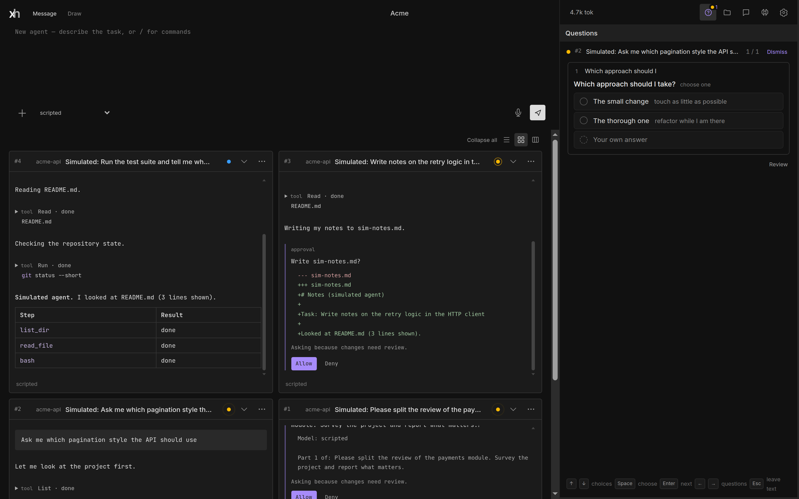

# Xhaos

**A self-hosted workspace for running many AI coding agents at once, from your browser.**

Xhaos runs on your machine or server. You describe tasks; agents work on your projects with the model providers you choose, in parallel, while you watch their transcripts, answer their questions, and approve what they want to do. The server owns the work: close the browser and the agents keep going.



> **Status: early.** Xhaos is young and changes quickly. Expect rough edges, and read [Security](#security) before exposing it to a network.

## Features

- **Many agents, one page.** Start agents from one message box; follow each in a card with its live transcript, tool calls and diffs. Agents can start subagents and talk to each other through channels you can read.
- **Your models.** Anthropic, and any OpenAI-compatible endpoint: OpenAI, DeepSeek, or a local Ollama, llama.cpp or vLLM server. Token use and cost per agent and model. A free simulated provider to try everything without a key.
- **You stay in control.** Every tool call passes a policy gate: reads run, writes and commands wait for your Allow (or run under auto review, per agent), and pushes always ask. Questions from agents land in one inbox.
- **Sandboxed commands.** Agents' shell commands run under Landlock (Linux): they reach their own project and nothing else of your home folder, no SSH agent, no Docker socket.
- **A secrets vault that agents can use but not read.** Grant a token or SSH key to an agent; a command that uses it runs sealed, can reach only that secret's hosts, and the value is masked in its output.
- **Workspaces.** Separate sets of agents, projects, keys and secrets, each with its own passphrase and encryption key, picked like profiles.
- **Tools beyond the basics.** MCP servers (stdio and HTTP), skills in Claude Code's format, web fetch and search, file attachments, sketches, and shared memories.
- **One static binary.** Pure Go with SQLite built in and the page embedded: copy it to a Linux server and run it. Works on a phone, too.

## Quick start

You need Linux (macOS works without the command sandbox), [Go 1.26+](https://go.dev/dl/), [Node.js 22.18+](https://nodejs.org), and `git` and `bash` for your agents.

```sh
git clone https://github.com/devark28/xhaos.git
cd xhaos
npm ci
scripts/server.sh -root ~/code/my-project
```

Open http://localhost:5180, name your first workspace and choose its passphrase, then add a model provider in Settings → Models (choose "Simulated" to try it without a key). Type a task in the message box and press Enter.

`-root` registers a project at startup; you can add more from the Files tab. Data lives in `~/.local/share/xhaos/`.

### On a server

On a Linux server with systemd (Debian or Ubuntu for the optional parts), the installer sets up everything and updates it later:

```sh
curl -fsSL https://raw.githubusercontent.com/devark28/xhaos/main/install.sh | sh
```

It installs the latest release (checksum verified), creates the `xhaos` user and a systemd service, and offers optional parts: build tools and languages, browsers for UI tests, rootless Podman, and speech dictation with a local Whisper model. Run it again to update. See [docs/deploy.md](docs/deploy.md#the-installer).

Or build a static binary with the page built in yourself:

```sh
scripts/release.sh            # release/xhaos-<version>-linux-{amd64,arm64}.tar.gz
```

or use the container:

```sh
docker build -t xhaos .
docker run -d --name xhaos -p 127.0.0.1:5180:5180 \
  -v xhaos-data:/data -v /srv/projects:/projects xhaos
```

[docs/deploy.md](docs/deploy.md) covers running it as a systemd service, behind an HTTPS reverse proxy (Caddy, nginx), and what to secure.

## Documentation

- [User guide](docs/guide.md): workspaces, models, projects and agents, approvals, the sandbox, channels, secrets, skills, and the page.
- [Deploying](docs/deploy.md): servers, containers, reverse proxies.
- [Architecture](docs/architecture.md): how the code is organized; [design notes](docs/design-notes.md): why.
- [Permissions](docs/permissions.md) and [skills](docs/skills.md).
- [MCP access](docs/mcp.md): drive agents from Claude Code (or any MCP client) with scoped tokens.

## Security

Xhaos runs AI agents that execute commands on the machine it runs on, so treat it like a shell:

- Every workspace has a passphrase; nothing but the sign-in page answers without a session, and a session reaches only its own workspace. API keys and secrets are encrypted at rest with a key only the passphrase unlocks.
- Agents' commands are sandboxed with Landlock (Linux 5.13+; secrets need 6.7+). Check Settings → Tools to see whether your kernel supports it. Without it, commands can reach anything the server's user can.
- Run Xhaos as its own unprivileged user, and put it behind HTTPS before it is reachable from anywhere but your machine.
- Workspaces separate your work; they are not a boundary between people who must not trust each other. For that, run separate instances.

Found a vulnerability? Please report it privately: see [SECURITY.md](SECURITY.md).

## Contributing

Contributions are welcome. [CONTRIBUTING.md](CONTRIBUTING.md) explains how to set up a development environment, run the tests, and send a change.

## License

[MIT](LICENSE) © 2026 devark28
